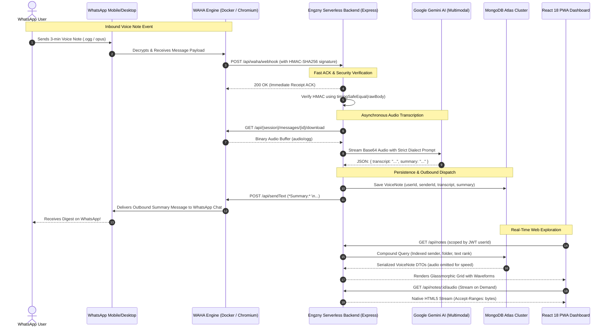
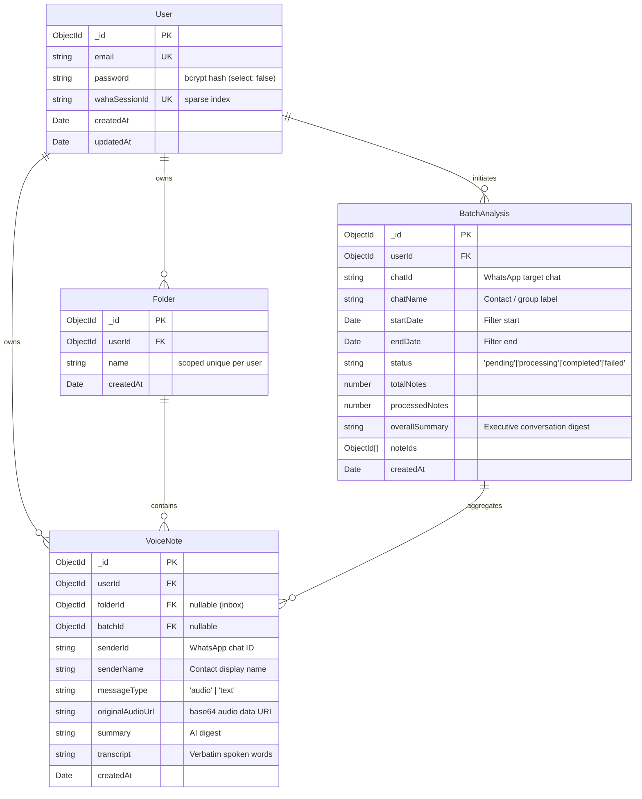

<div align="center">

# ⚡ Engzny (إنجزني)
### Production-Grade WhatsApp Voice Note Summarizer & Conversational Intelligence Platform

[](https://github.com/AntonyosMiladFahim/engzny/actions)
[](https://github.com/AntonyosMiladFahim/engzny)
[](https://react.dev/)
[](https://nodejs.org/)
[](https://vitejs.dev/)
[](https://tailwindcss.com/)
[](https://www.mongodb.com/)
[](https://deepmind.google/technologies/gemini/)
[](https://waha.devlike.pro/)
[](https://web.dev/progressive-web-apps/)
[](https://opensource.org/licenses/ISC)

<br />

**Engzny** (*from the Egyptian Arabic slang **"إنجزني"** — meaning "Save my time", "Get it done quickly", or "Cut to the chase"*) is a multi-tenant AI SaaS that converts endless WhatsApp voice notes into structured, instant digests and verbatim transcripts in seconds.

Built with **Node.js, Express, React 18, Google Gemini Multimodal Audio AI, MongoDB, and WAHA (WhatsApp HTTP API)**, Engzny bridges real-world messaging habits with enterprise-grade distributed systems architecture.

[Explore Features](#-core-features--engineering-highlights) • [System Architecture](#-system-architecture) • [API Reference](#-api-reference) • [Quickstart Guide](#-quickstart--local-setup) • [Security & Isolation](#-security-tenancy--hardening)

---

</div>

## 📌 Executive Summary

Modern messaging apps thrive on voice notes, but busy professionals, students, and operators suffer from "voice note fatigue" — losing hours listening to rambling, unstructured voice clips in meetings, noisy transit, or urgent situations.

**Engzny solves this with an autonomous, zero-friction pipeline:**
1. **Instant Voice Note Ingestion**: Forward or record a voice note in WhatsApp; the automated WAHA gateway routes it into Engzny via signed webhooks.
2. **Native Multimodal Audio AI Processing**: Directly fed into Google Gemini's audio pipeline (no lossy intermediate audio transcode or slow FFmpeg conversion).
3. **Bilingual & Dialect-Preserving AI Summaries**: Detects and responds strictly in the speaker's language (Egyptian Arabic, Modern Standard Arabic, Franco-Arab, English, or code-switched multi-language dialects) with zero hallucinated markdown.
4. **Immediate WhatsApp Autoreply**: An executive summary is fired back to the WhatsApp chat within seconds.
5. **Interactive Web & Mobile Dashboard**: Voice notes are cataloged in an ultra-fast, responsive glassmorphic library with on-demand audio streaming, procedural animated waveforms, verbatim transcripts, folder categorization, and deep full-text search.
6. **"Analyze All" Bulk Chat Intelligence**: Retroactively inspects and summarizes hundreds of voice and text messages across any WhatsApp conversation over custom date ranges.
7. **PWA Level-3 Web Share Target**: Native OS integration allows mobile users to share audio files from any app directly into Engzny with an interactive contact routing wizard.

---

## 🏗️ System Architecture

Engzny operates as a decoupled, event-driven distributed system designed for serverless execution on **Vercel** backed by **MongoDB Atlas** and self-hosted **WAHA** nodes behind an encrypted edge tunnel.

### End-to-End Ingestion & Processing Pipeline



---

## ✨ Core Features & Engineering Highlights

### 1. Multimodal Audio Intelligence (Google Gemini)
* **Direct Audio Processing**: Sends binary audio chunks directly into Gemini's multimodal engine without lossy intermediate WAV/MP3 conversion or expensive speech-to-text transcription chaining.
* **Dialect & Language Fidelity**: Explicitly engineered to respect dialectal Egyptian Arabic (`عايز أقولك`, `هنخلص امتى`), Franco-Arab, English, and technical code-switching. It outputs strictly in the language spoken without translating to English or adding boilerplate conversational fluff.
* **Strict Schema Adherence**: Enforces strict JSON contracts (`{ transcript: string, summary: string }`). Automatically scrubs accidental model markdown formatting and provides resilient fallback parsing so zero voice notes are lost.

### 2. Zero-Loss WhatsApp Webhook Pipeline & HMAC Security
* **Sub-Millisecond 200 OK Acknowledgement**: WAHA retries unacknowledged webhooks up to 15 times with exponential backoff. The webhook route responds with `200 OK` synchronously on arrival, offloading work to an isolated Node.js event-loop tick (`setImmediate`).
* **Cryptographic HMAC-SHA256 Verification**: Payload authentication via `x-webhook-hmac`. Captures the unparsed `Buffer` at the Express body-parser level (`req.rawBody`) to prevent JSON key-reordering discrepancies. Uses `crypto.timingSafeEqual` to eliminate timing-oracle vulnerabilities.
* **Media-Type Filtering Guard**: Rejects status broadcasts (`status@broadcast`), stickers, images, and videos before touching the AI pipeline, protecting compute quotas and memory.

### 3. "Analyze All" Bulk Chat Intelligence & Conversation Synthesis
* **Historical Date/Time Range Auditing**: Select any WhatsApp group or 1:1 chat and specify a temporal window (Today, Last 7 Days, Last 30 Days, or custom timestamps).
* **Mixed-Media Chat Extraction**: Scans hundreds of messages, parsing both textual context and voice notes chronologically.
* **Executive Summary Synthesis**: Aggregates the entire conversation history into an overarching executive summary highlighting critical decisions, assignments, topics, and unresolved questions.
* **Dedicated Partitioned View**: A dedicated dashboard tab displays batch progress (`pending` → `processing` → `completed`), processed-to-total counters, and a message-by-message timeline.

### 4. PWA Level-3 Web Share Target & Offline Ingestion
* **Native Mobile Integration**: Registered under the W3C Web Share Target API. Users can select any audio file on their device, tap **Share**, and choose **Engzny**.
* **IndexedDB Share Inbox**: Inbound files land in a local IndexedDB queue (`engzny-share-inbox`) with FIFO automatic pruning.
* **Interactive Share Routing Wizard (`ShareRoutingModal`)**: When shared audio arrives, the user is presented with a dialog showing their WhatsApp contacts and recent chats. The user routes the file to the corresponding sender before AI processing, ensuring accurate library attribution.
* **Full Offline Resilience**: The custom Service Worker precaches the SPA app shell, fonts, and static assets, falling back to a custom offline dashboard when disconnected.

### 5. Audiophile-Grade Streaming & Procedural Waveforms
* **Byte-Range Audio Streaming (`GET /api/notes/:id/audio`)**: Note listings exclude the bulky base64 audio payload (`originalAudioUrl` is omitted during bulk fetches), keeping queries ultralight. The browser streams raw audio on demand with HTTP `Accept-Ranges: bytes` and `Cache-Control: private, max-age=3600`.
* **Procedural Deterministic Waveforms**: Generates visually authentic, unique 22-bar audio waveforms keyed to each voice note's unique identifier.
* **Interactive Visualizer**: Animated Framer Motion wave visualizer with live scrubbing progress, play/pause state machines, and micro-interactions.

### 6. Dual-Tier Multilingual Search Engine
* **Compound MongoDB Text Index**: Indexes `{ senderName: 8, transcript: 6, summary: 4 }` with `default_language: 'none'`. This prevents English stemmers from corrupting Arabic and mixed-script tokens.
* **Intelligent Substring Fallback**: Standard text indices require full-token matches. Engzny implements a seamless, case-insensitive regex fallback across sender, transcript, and summary, so typing a partial word (e.g., `"meet"`) immediately surfaces notes containing `"meeting"`.
* **Global Keyboard Shortcuts**: Instantly activates with `⌘K` or `/` from anywhere in the application.

### 7. Multi-Tenant Isolation & OWASP Hardening
* **Hermetic User Isolation**: Every collection (`VoiceNote`, `Folder`, `BatchAnalysis`) enforces a mandatory `userId` foreign key. Controllers automatically scope all queries through the authenticated JWT payload (`req.user.id`).
* **Deterministic WhatsApp Sessions**: WAHA session IDs are permanently mapped to the authenticated user's MongoDB `ObjectId`. Users cannot manipulate or inspect other tenants' WhatsApp sessions through query parameters, headers, or body inputs.
* **Timing-Uniform Authentication**: Passwords use bcrypt with a work factor of 12. Non-existent email login attempts trigger a comparison against a precomputed dummy hash (`getDummyHash()`) to make response times indistinguishable, preventing email enumeration attacks.
* **Strict NoSQL Injection Shields**: Explicit `typeof` runtime assertions guarantee that malicious JSON query objects (such as `{"$gt": ""}`) cannot be injected into Mongoose filter clauses.

---

## 📐 Data Models & Schema Architecture



### Database Optimization Highlights
| Collection | Index Strategy | Purpose |
| :--- | :--- | :--- |
| **`User`** | `{ email: 1 }` (unique, lowercase) | Fast login lookup and duplicate prevention under concurrent registrations. |
| **`User`** | `{ wahaSessionId: 1 }` (unique, sparse) | 1:1 session-to-tenant guarantee without blocking users who haven't linked WhatsApp. |
| **`Folder`** | `{ userId: 1, name: 1 }` (unique compound) | Permits identical folder names across different users while forbidding duplicates per account. |
| **`VoiceNote`** | `{ userId: 1, folderId: 1, createdAt: -1 }` | Powers the primary library feed with zero in-memory sorting. |
| **`VoiceNote`** | `{ userId: 1, senderId: 1, createdAt: -1 }` | Fast aggregation for the Contacts navigation rail and sender-filtered chat views. |
| **`VoiceNote`** | `{ senderName: "text", transcript: "text", summary: "text" }` | Compound full-text search with customized field weighting (8 : 6 : 4). |

---

## 🛠️ Tech Stack & Architecture Decisions

| Layer | Technology | Decision Rationale |
| :--- | :--- | :--- |
| **Frontend Framework** | **React 18** (Hooks, Context, Portals) | Predictable state flow, optimized concurrent rendering, and flexible component composition. |
| **Bundler & Tooling** | **Vite 4.5** | Sub-second HMR in development and tree-shaken, content-hashed production chunks. |
| **Styling & Design** | **Tailwind CSS + Framer Motion** | Dark-mode glassmorphic design system with physics-based spring transitions and accessibility considerations (`useReducedMotion`). |
| **Icons & Typography** | **Lucide React + Cantarell / JetBrains Mono** | Crisp, scalable iconography paired with high-legibility typography for tabular data and transcripts. |
| **Backend Runtime** | **Node.js (LTS) + Express** | High-throughput asynchronous I/O ideal for webhook ingestion, streaming responses, and proxying AI calls. |
| **AI / Audio Engine** | **Google Gemini Multimodal API** | Direct multimodal audio decoding, exceptional Arabic dialect comprehension, and cost-effective latency. |
| **WhatsApp Gateway** | **WAHA (WhatsApp HTTP API)** | Self-hosted headless WhatsApp Web automation with multi-session support, pairing codes, and webhooks. |
| **Database & ODM** | **MongoDB Atlas + Mongoose 8** | Flexible JSON schema for unstructured AI outputs, robust aggregation pipelines, and compound text indexing. |
| **Testing** | **Jest + Supertest + Vitest + JSDOM** | 95 isolated backend unit/integration tests with in-memory WAHA mock servers and frontend component suites. |
| **Deployment** | **Vercel Serverless + Docker Compose** | Serverless Node backend with instant edge deployments, paired with containerized WAHA and Ngrok tunnels. |

---

## 🔌 API Reference

All protected endpoints require an `Authorization: Bearer <token>` header.

### Authentication (`/api/auth`)
| Method | Endpoint | Access | Description |
| :--- | :--- | :--- | :--- |
| `POST` | `/api/auth/register` | Public | Registers a new account with email validation and bcrypt hash. |
| `POST` | `/api/auth/login` | Public | Authenticates credentials with constant-time dummy hash verification. |
| `GET` | `/api/auth/me` | Protected | Returns the authenticated tenant's profile without sensitive fields. |

### WhatsApp & WAHA Management (`/api/waha`)
| Method | Endpoint | Access | Description |
| :--- | :--- | :--- | :--- |
| `POST` | `/api/waha/webhook` | Public (HMAC) | Receives incoming messages from WAHA. Verified via HMAC-SHA256. |
| `POST` | `/api/waha/pair` | Protected | Spins up the user's WAHA session and returns an 8-character pairing code. |
| `GET` | `/api/waha/status` | Protected | Checks if the user's WhatsApp session is active and linked (`WORKING`). |
| `GET` | `/api/waha/chats` | Protected | Fetches paginated active chats (`limit`, `offset`) with last message snippets. |

### AI & Bulk Chat Analysis (`/api/ai`)
| Method | Endpoint | Access | Description |
| :--- | :--- | :--- | :--- |
| `POST` | `/api/ai/upload` | Protected | Manual/PWA upload of a base64 audio payload to summarize and file. |
| `POST` | `/api/ai/batch-analyze` | Protected | Initiates an asynchronous bulk chat analysis over a specified date range. |
| `GET` | `/api/ai/batches` | Protected | Lists all historical bulk analysis jobs for the authenticated user. |
| `GET` | `/api/ai/batches/:id` | Protected | Retrieves full details, individual messages, and executive summary for a batch. |

### Notes & Library (`/api/notes`)
| Method | Endpoint | Access | Description |
| :--- | :--- | :--- | :--- |
| `GET` | `/api/notes` | Protected | Lists notes with optional query filters: `folder`, `sender`, `search`, `limit`. |
| `GET` | `/api/notes/contacts` | Protected | Aggregates unique WhatsApp senders ordered by most recent communication. |
| `GET` | `/api/notes/:id/audio` | Protected | Streams raw audio bytes with range support (`Accept-Ranges: bytes`). |
| `DELETE` | `/api/notes/:id` | Protected | Permanently deletes a voice note belonging to the tenant. |

### Folders (`/api/folders`)
| Method | Endpoint | Access | Description |
| :--- | :--- | :--- | :--- |
| `GET` | `/api/folders` | Protected | Lists all user folders along with real-time note counts. |
| `POST` | `/api/folders` | Protected | Creates a new organization folder (unique per user). |

---

## 🚀 Quickstart & Local Setup

### Prerequisites
* **Node.js**: v18.0.0 or later (Node 22 LTS recommended)
* **npm**: v9.0.0 or later
* **Docker & Docker Compose**: For running WAHA and local tunnels
* **MongoDB**: A running local instance or MongoDB Atlas connection URI
* **Google Gemini API Key**: Obtainable from [Google AI Studio](https://aistudio.google.com/)

---

### Step 1: Clone & Install Dependencies

```bash
git clone https://github.com/AntonyosMiladFahim/engzny.git
cd engzny

# Install root dependencies (Express, React, Vite, Jest, Tailwind)
npm install
```

---

### Step 2: Configure Environment Variables

Create a `.env` file in the project root:

```env
# Server Configuration
PORT=5000
NODE_ENV=development

# Database Connection
MONGODB_URI=mongodb://localhost:27017/engzny

# Authentication Secret (min 32 random characters)
JWT_SECRET=super-secret-jwt-key-replace-with-secure-value-32chars

# Google Gemini API
GEMINI_API_KEY=AIzaSyYourGeminiApiKeyHere

# WAHA (WhatsApp HTTP API) Configuration
WAHA_URL=http://localhost:3000
WAHA_API_KEY=local-dev-api-key
WAHA_WEBHOOK_HMAC_KEY=optional-hmac-shared-secret
```

Create a `docker/.env` file for running the containerized infrastructure:

```env
WAHA_PORT=3000
WAHA_API_KEY=local-dev-api-key
WAHA_DASHBOARD_USERNAME=admin
WAHA_DASHBOARD_PASSWORD=admin
WAHA_ENGINE=WEBJS
WAHA_WEBHOOK_URL=http://host.docker.internal:5000/api/waha/webhook
WAHA_WEBHOOK_HMAC_KEY=optional-hmac-shared-secret

# Optional Ngrok / Cloudflare Tunnel variables for public webhook forwarding
NGROK_AUTHTOKEN=your-ngrok-token
NGROK_DOMAIN=your-custom-domain.ngrok-free.app
```

---

### Step 3: Launch Local WAHA WhatsApp Gateway

Start the WAHA container using Docker Compose:

```bash
docker compose -f docker/docker-compose.yml up -d
```

Verify that WAHA is running and healthy:
```bash
docker compose -f docker/docker-compose.yml ps
```
> The WAHA dashboard and Swagger UI will be accessible at `http://localhost:3000` (credentials: `admin` / `admin`).

---

### Step 4: Run the Full-Stack Application

Launch both backend and frontend concurrently with a single command:

```bash
npm run dev
```

* **Frontend Dashboard**: `http://localhost:5173`
* **Backend API**: `http://localhost:5000`

---

## 🧪 Testing & Verification

Engzny incorporates an enterprise test suite validating security boundaries, tenant isolation, AI parsing edge cases, and end-to-end webhook interactions.

```bash
# Execute Jest test suite (unit and integration tests)
npm test
```

### Test Suite Coverage Overview
* **Authentication Suite (`_authController.test.js`)**:
  * Validates password hashing, bcrypt rounds, and email normalization.
  * Asserts constant-time execution on unknown email attempts.
  * Tests resistance to NoSQL injection payloads (`{ "$gt": "" }`).
* **Tenant Isolation & WAHA Integration (`_waha.integration.test.js`)**:
  * Boots an in-memory mock WAHA server.
  * Simulates adversarial attempts by User A to read or hijack User B's WhatsApp session.
  * Verifies that session names are strictly derived from verified JWT subjects.
* **AI Controller & Webhook Suite (`_aiController.test.js`)**:
  * Validates markdown fence stripping and structured JSON parsing.
  * Tests non-audio media rejection and status broadcast filtering.
  * Tests unparseable model fallback handling without data loss.
* **Batch Chat Analysis Suite (`_batchAnalysis.test.js`)**:
  * Validates date/time range query filters, sorting, and message extraction.

```text
PASS api/__tests__/_authMiddleware.test.js
PASS api/__tests__/_aiController.test.js
PASS api/__tests__/_batchAnalysis.test.js
PASS api/__tests__/_authController.test.js
PASS api/__tests__/_waha.integration.test.js

Test Suites: 5 passed, 5 total
Tests:       95 passed, 95 total
Snapshots:   0 total
Time:        21.624 s
Ran all test suites.
```

---

## 📂 Project Directory Structure

```text
engzny/
├── .github/
│   └── workflows/
│       └── ci.yml                     # GitHub Actions CI gate (lint, test, build)
├── api/                               # Backend application (Express & Vercel serverless)
│   ├── _config/
│   │   ├── _db.js                     # Cached Mongoose connection handler
│   │   ├── _jwt.js                    # JWT signing, verification, and claims
│   │   └── _waha.js                   # Thin HTTP client for WAHA WhatsApp API
│   ├── _controllers/
│   │   ├── _aiController.js           # Gemini AI summarization, uploads, and batch jobs
│   │   ├── _authController.js         # Register, login, and tenant verification
│   │   ├── _wahaController.js         # Tenant-scoped session pairing and webhooks
│   │   └── _whatsappController.js     # Supplementary WhatsApp device management
│   ├── _middlewares/
│   │   └── _authMiddleware.js         # JWT bearer token verification & user population
│   ├── _models/
│   │   ├── _BatchAnalysis.js          # Bulk chat analysis jobs schema & status
│   │   ├── _Folder.js                 # User folder buckets schema with compound uniqueness
│   │   ├── _User.js                   # Tenant user schema with bcrypt & WAHA session mapping
│   │   └── _VoiceNote.js              # Voice note schema, compound & weighted text indexes
│   ├── _routes/
│   │   ├── _ai.js                     # AI upload, webhook, and batch endpoints
│   │   ├── _auth.js                   # Authentication endpoints
│   │   ├── _folders.js                # Folder management endpoints
│   │   ├── _notes.js                  # Notes listing, audio streaming, and deletion
│   │   └── _waha.js                   # WAHA pairing, status, and chat endpoints
│   ├── _utils/
│   │   └── _contact.js                # Phone formatting, display name fallbacks, and regex
│   ├── __tests__/                     # Backend test suites (Jest + Supertest)
│   └── index.js                       # Express app entrypoint & raw-body capture
├── docker/
│   ├── docker-compose.yml             # WAHA service, Ngrok tunnel, and persistent volumes
│   └── .env.example                   # Docker environment template
├── public/
│   ├── icons/                         # Progressive Web App vector & maskable icons
│   ├── screenshots/                   # Responsive UI preview assets
│   └── manifest.json                  # PWA Web Manifest & Web Share Target registration
├── src/                               # Frontend Single-Page Application (React 18 + Vite)
│   ├── components/
│   │   ├── auth/                      # Authentication cards, layouts, and brand assets
│   │   ├── connect/                   # WhatsApp pairing wizard, scanner, and sweep animations
│   │   ├── dashboard/                 # Note cards, grid, drawers, modals, and batch views
│   │   ├── shell/                     # App shell wrappers and user badge chips
│   │   └── ui/                        # Reusable primitives (Button, Highlight, Toaster, etc.)
│   ├── context/
│   │   └── AuthContext.jsx            # Global auth state & persistent session provider
│   ├── hooks/
│   │   ├── useLibrary.js              # Reactive SWR-like data hooks (notes, folders, contacts)
│   │   ├── useTilt.js                 # 3D interactive card tilt & specular sheen physics
│   │   ├── useWahaPolling.js          # Real-time WhatsApp connection status poller
│   │   └── useWahaQr.js               # Reactive pairing code lifecycle manager
│   ├── pages/
│   │   ├── ConnectWhatsApp.jsx        # Interactive 3-step WhatsApp pairing page
│   │   ├── Dashboard.jsx              # Main library view, search rail, and chat timeline
│   │   ├── Login.jsx                  # Tenant sign-in view
│   │   └── Register.jsx               # Tenant onboarding view
│   ├── services/
│   │   └── api.js                     # Axios instance with auth interceptors
│   ├── App.jsx                        # React Router configuration & route protection
│   ├── main.jsx                       # React DOM root entrypoint
│   └── service-worker.js              # Offline cache strategies & Web Share Target listener
├── package.json                       # Scripts, dependencies, and build configuration
├── tailwind.config.js                 # Design tokens, typography, and custom color palettes
├── vercel.json                        # Serverless rewrite rules & static build targets
└── vite.config.js                     # Vite build, proxy, and service-worker rollup config
```

---

## 🔒 Security, Tenancy & Hardening

Engzny is engineered under strict defense-in-depth principles:

1. **NoSQL Injection Immunity**: 
   All endpoints parsing user credentials or filter parameters enforce strict type verification. Unsafe objects containing MongoDB operators (`$gt`, `$ne`, `$regex`) are rejected before reaching database queries.
2. **Timing-Attack Resistance**:
   Logins for non-existent email addresses perform a live bcrypt comparison against a cached random hash (`getDummyHash()`), guaranteeing that response durations remain identical regardless of whether an account exists.
3. **Multi-Tenant Session Integrity**:
   WAHA sessions cannot be cross-referenced or hijacked. The session identifier is strictly derived on the server from the cryptographically verified JWT payload (`req.user.id`). Client-provided session overrides in query strings or request bodies are discarded.
4. **Data Minimization Over the Wire**:
   Voice note audio payloads can reach several megabytes. The `/api/notes` listing endpoint strips `originalAudioUrl` entirely from bulk responses (`hasAudio: boolean` is returned instead). Audio bytes are served only when a user explicitly presses play via the dedicated, ownership-checked streaming route (`GET /api/notes/:id/audio`).

---

## 🚢 Production Deployment

Engzny is production-ready for deployment across modern cloud platforms:

### Vercel Serverless (Recommended)
1. Link your GitHub repository to Vercel.
2. Add the environment variables (`MONGODB_URI`, `JWT_SECRET`, `GEMINI_API_KEY`, `WAHA_URL`, `WAHA_API_KEY`) in the Vercel dashboard.
3. The included `vercel.json` automatically configures the static Vite build for the frontend and routes `/api/*` to the Node.js serverless function.

### Self-Hosted / Docker
1. The frontend can be compiled via `npm run build` and served via Nginx or Cloudflare Pages.
2. The Express server (`api/index.js`) can be run directly with Node 22 or packaged in a lightweight container alongside the WAHA Docker Compose service.

---

## 👨‍💻 Author

**Antonyos Milad Fahim**
* GitHub: [@AntonyosMiladFahim](https://github.com/AntonyosMiladFahim)
* Project Repository: [https://github.com/AntonyosMiladFahim/engzny](https://github.com/AntonyosMiladFahim/engzny)

---

<div align="center">
  <sub>Built with precision, curiosity, and respect for engineering excellence.</sub>
</div>
